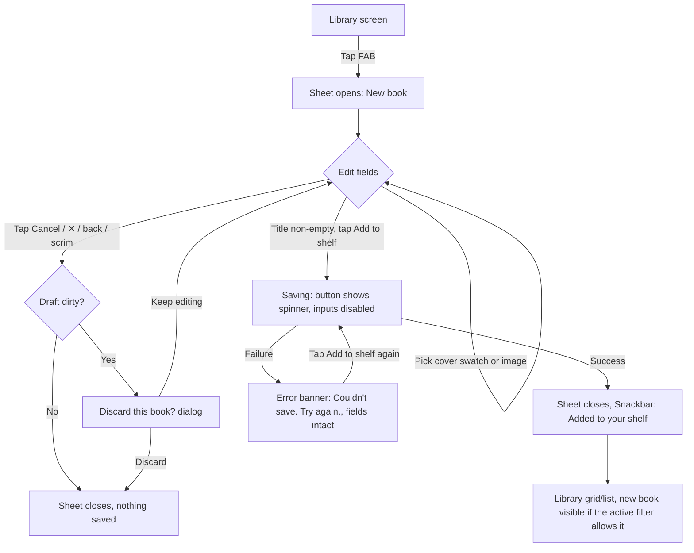

# Add a book manually
Status: Draft   Owner: UX   Date: 2026-10-27

## Context
Problem: there is no way to put a book on the shelf except through a future scan/search flow. #31 adds the first and simplest path — a manual form — reachable from the Library FAB (`LibraryAddBookFab`, #22).
Goal: let a user record a book they own in under a minute, with only a title required, and always land it in "Want to read" (epic D10).
Users: the single local app user, on their own phone (no multi-user, no backend).
Success: AC1–AC5 in the ticket (gated save, always `want_to_read`, unset rating ≠ 1 star, cover is one of image/preset, Cancel discards).

This spec binds to the architect's plan (`docs/plans/31-add-book-manually.md`, section 4, "Contract (binding)") and ADR-003 (cover image storage). Where this spec requires a UI state not named in section 4.2's `AddBookUiState`/`AddBookDraft`/intents, it reuses what the fields already express (`isDirty`, `canSave`, `error`, `isImportingImage`, `isSaving`) — nothing here asks for a new state field.

No existing research applies (first manual-entry flow, nothing in the product to compare against); no primary research is warranted at this ticket's risk — it is a single, previously-static wireframe frame turned into a working form, not a novel task. Findings below are sourced from the wireframe (`project/wireframe_images/Add_New_Book_Screen.png`), the Visual Spec §5.9–5.14, established platform/heuristic guidance (Material 3 bottom sheets, WCAG 2.2), and the plan's binding contract — labelled per claim.

## Assumptions and open questions

| # | Item | Type | Owner | Status |
|---|---|---|---|---|
| 1 | A dirty draft (any field changed from `BookDraft.Empty`, or an image picked) shows a "Discard this book?" confirm dialog on Cancel / ✕ / back / scrim tap; a clean draft exits immediately. | Assumption, reasoned from Nielsen heuristic #5 (error prevention) applied to a form with no autosave and an async image file to clean up — see §2 "Dismiss policy" | UX (this spec resolves plan A9's open point) | Resolved — proceeding |
| 2 | The scrim **does** dismiss (routed through the same `onDismissRequest()` as ✕, following the same dirty-check), matching the Visual Spec §5.10 pattern ("Closes on Esc, a scrim click, or ✕") even though this is Android, not the web prototype. | Assumption | UX / FE | Resolved — proceeding; flag to SA below |
| 3 | Post-save confirmation: a Snackbar reading "Added to your shelf" is shown (plan A12 makes this spec's call; Visual Spec §5.14 already defines the exact copy and toast styling, repurposed as a Snackbar on Android). | Assumption | UX (resolved in §7 below) | Resolved — proceeding |
| 4 | `Remove` on a set cover image reverts to `lastPreset`, defaulting to Preset 1 if no preset was ever explicitly chosen in this session (plan §4.2 leaves the exact preset to this spec). | Assumption | UX (resolved in §6 below) | Resolved — proceeding |
| 5 | Whether the scrim-tap-dismisses behavior is consistent with other Android sheets in the app, and whether a *modal* bottom sheet convention (scrim never submits/discards without confirmation) creates a platform-conformance question against `DialogProperties(dismissOnClickOutside = false)` already set in the plan's nav contract (4.1) — the plan explicitly turns off the system's own click-outside dismissal and routes it manually instead. | Flag for SA/FE: confirm the manual scrim-tap handler (an `Box.clickable` behind the sheet content, inside the `dialog` composable) is the intended mechanism, not a missed wiring of `dismissOnClickOutside`. | SA / FE | Open — does not block; default in item 2 stands either way |

## User flow

Failure paths covered: image import failure (stays on the form, §6), save failure (stays on the form, §7), accidental dismissal of a part-filled form (§2), process death mid-draft (handled by `SavedStateHandle`, plan §4.2 — no UI difference, the form simply reappears as it was).

## Screens / components

### 1. Add Book sheet (`AddBookRoute` / `BookForm`)

**Purpose and when it appears:** the only entry point for manual book entry (plan D12/A2), opened by the Library FAB. A Navigation `dialog` destination drawn as a bottom-anchored sheet over the Library, per plan A1.

**Layout and hierarchy:**
- Full-width bottom sheet, top corners rounded 22dp (consistent with Visual Spec §5.10 "22px top corners" — these are px in a web mock at 1x, treated as dp on Android, no new token).
- **Header** (pinned, does not scroll): "New book" title, `MaterialTheme.typography.titleLarge` (Fraunces SemiBold 22sp, forest/`primary`), left-aligned with 20dp horizontal padding; a ✕ icon button, 48×48dp touch target, top-right, `contentDescription` = "Close". A 1dp `outlineVariant` (`line` token) divider below the header — solid, not dashed (dashed borders exist only in the web prototype's CSS; the app has no existing dashed-border primitive, so this spec uses the app's one existing divider treatment rather than introduce one. Flag to FE: if a dashed `Canvas`-drawn divider is trivial to add consistently with the hand-drawn icon pattern, it is a closer visual match to the wireframe and acceptable as a like-for-like substitution — UX has no preference beyond "not a new color").
- **Body**: vertically scrollable, independent of header/footer. Field order, top to bottom, matches the wireframe exactly: section head "BOOK" → Title → Author / Year (two columns, stack to one column below 360dp width) → Rating → Short comment → section head "COVER" → cover picker. 16dp vertical gap between fields, 24dp before a new section head (mirrors Visual Spec §5.11's "16px below" / §5.11 section-head rule, applied with in-code spacing, no new token).
- **Footer** (pinned, does not scroll): right-aligned "Cancel" (text button, `onSurfaceVariant`/`ink_muted`) and "Add to shelf" (filled button, `primary`/forest fill, `onPrimary`/paper text), 10dp gap between them, 16dp padding all around, sits **above the IME** at all times (see below). 1dp `outlineVariant` divider above the footer.

**Sheet sizing and insets (Android specifics — plan A1's `dialog` with `usePlatformDefaultWidth = false, decorFitsSystemWindows = false`):**
- Max height: 92% of the window height (matches Visual Spec §5.10 mobile sheet, `92vh`), measured **after** subtracting the status bar inset so the sheet never visually touches the status bar. Below 92%, the sheet height is content-driven (wraps), so a short form (title only) does not force a near-full-screen sheet with empty space — height 0.92x is a ceiling, not a fixed value.
- The sheet consumes the navigation-bar inset as bottom padding on the **footer**, so the footer's buttons never sit under 3-button or gesture navigation.
- When the IME opens (focusing Author/Year/Comment), the body's bottom padding grows by the IME inset so the focused field scrolls fully above the IME; the **footer stays pinned immediately above the IME**, never hidden behind it and never pushed off-screen. Use `WindowInsets.ime` combined with `imePadding()` on the footer, and the body consumes the remainder. Use `imeNestedScroll()` behavior so dragging the body doesn't fight IME show/hide animations.
- **Landscape:** the 92% height ceiling still applies, but on short landscape displays the body is frequently the limiting factor — content must remain independently scrollable with header/footer pinned; no field may be clipped or unreachable. No layout other than stacking Author/Year back to two columns (there's room) changes.
- **320dp width:** the minimum supported width (plan: no explicit floor stated, but 320dp is the practical Android minimum). At 320dp, Author/Year must already be single-column (below the 360dp breakpoint stated above), the star row must not clip (5 stars × 32dp touch target + 4×4dp gaps = 176dp, comfortably under 320dp minus 32dp horizontal padding = 288dp), and the 6 cover swatches (32×44dp + 8dp gaps = 232dp) must fit on one row within the same 288dp budget — confirmed to fit; if a future preset is added, wrap to two rows rather than shrink swatches below 32×44dp.
- **2× font scale:** every label, button and field uses `sp`, never a fixed `dp` text box — Compose scales automatically. At 2×, the two-column Author/Year row must still not clip label text; if "AUTHOR"/"YEAR" labels or input hints truncate at 2× in a 320dp-wide single column, that is acceptable (ellipsis), but the input fields and buttons themselves must never clip or overlap. The footer buttons wrap their label at 2x scale without cutting text — use `FlowRow`-style wrapping or stack Cancel above Add to shelf vertically if the two don't fit on one line at max scale and max width constraints (rare case, but must not truncate "Add to shelf" to "Add to sh…").

**Components used (existing):** M3 `TextField`/`OutlinedTextField`-equivalent inputs styled per Visual Spec §5.11 token mapping below, M3 `FloatingActionButton`-adjacent button styles already used elsewhere (forest fill, paper text — same pair as the FAB), `Canvas`-drawn glyphs (✕, stars, stepper chevrons) per the project's no-`material-icons-core` rule (plan A4, note under "Icons").

**New components needed (justified, all within `features/library/ui/bookform/` per plan A4):**
- `StarRatingInput` — no M3 equivalent; see §5.
- `YearStepperField` — no M3 equivalent; see §4.
- `CoverPicker` — no M3 equivalent; see §6.

### 2. Discard confirm dialog

**Purpose:** prevents silent loss of a part-filled draft (open question 1, resolved).
**Appears when:** Cancel, ✕, system back, or scrim tap is triggered **and** `uiState.isDirty == true`.
**Layout:** reuses the pattern in Visual Spec §5.13 (centered dialog, `min(420px,92%)`, forest Slab 19/600 title, muted body, right-aligned buttons) via M3 `AlertDialog`, no custom component needed.
**Content:**
- Title: "Discard this book?"
- Body: "You'll lose the details you entered."
- Buttons: "Keep editing" (dismiss the dialog, return to the form, text button) and "Discard" (destructive, `terracotta` text per Visual Spec §1.3 "Danger / destructive" semantic mapping, right-aligned, rightmost).
**States:** default only — this is a lightweight confirm, no loading/error state. If `isSaving` is somehow true when a dismiss is requested, the dismiss request is ignored entirely (plan A9: "Ignored while `isSaving`") and this dialog never appears mid-save.
**Interaction:** tapping outside this dialog or pressing back is equivalent to "Keep editing" (do not discard on a second accidental outside-tap — that would defeat the point of the confirm).

## Responsive behavior

| Breakpoint | What changes |
|---|---|
| ≥ 360dp width | Author / Year render as two columns (`row-2`, Visual Spec §5.11), 12dp gap |
| < 360dp width (incl. 320dp floor) | Author / Year stack to one column, full width each |
| Landscape, short height | Sheet height ceiling (92%) likely binds; body scrolls independently; header/footer stay pinned; no field reflow beyond the width rule above |
| IME open | Footer stays pinned above IME; body's effective scrollable area shrinks; focused field auto-scrolls into view above the footer |
| 2× font scale | All text scales; footer buttons wrap to two lines rather than truncate if needed; swatch row and star row do not shrink below their minimum touch targets (§4–§6) |

## Accessibility

**Semantics and landmarks:**
- The sheet's root is a `Dialog`-hosted composable; set `Modifier.semantics { paneTitle = "New book" }` (or equivalent) on the sheet root so TalkBack announces entry into a new context, matching the visual header.
- Heading structure: "New book" (header) and the two section heads "Book" / "Cover" are marked as headings (`Modifier.semantics { heading() }`) so TalkBack's heading-navigation gesture can jump between them.

**Focus order:** Title → Author → Year → Rating (as one control, see §5) → Comment → Cover (Upload button → 6 swatches, left to right) → Cancel → Add to shelf → ✕ (✕ is reachable but placed last in reading order since it's a corner affordance reachable directly by touch; TalkBack linear navigation still reaches it before Cancel/Add to shelf is debatable — **recommendation: place ✕ immediately after the header title in focus order**, i.e. second overall, matching its visual position top-of-screen, not last). Revise: Title gets initial accessibility focus (see §3), ✕ is second in focus order (reachable right after the heading), then Author/Year/Rating/Comment/Cover/Cancel/Add-to-shelf in visual order.

**Focus management:**
- On sheet open: accessibility focus (TalkBack) moves to the header title "New book" first (announcing entry), input focus (IME) does **not** auto-open (see §3 — title does not autofocus the keyboard, to avoid surprising the user with the IME covering the sheet on open). This is a deliberate split: TalkBack users get an orientation announcement; sighted/keyboard users are not force-fed the IME.
- On sheet close (any path): focus returns to the Library FAB (the element that opened the sheet), so a screen-reader user isn't left on a removed node.
- On opening the discard-confirm dialog: focus moves to its title; on dismiss, focus returns to whichever control triggered it (✕, Cancel, or the sheet root for back/scrim).

**Accessible names:** every field's visible uppercase label ("TITLE", "AUTHOR", "YEAR", "RATING", "SHORT COMMENT", "COVER") is also the input's accessible name via `TextField`'s `label` slot (which M3 wires to both visually and to `contentDescription`/semantics automatically) — never relying on placeholder text alone as the accessible name (placeholder text like "The Wind in the Willows" must not be the only label, per WCAG 3.3.2 and this spec's own note in plan §3.9).

**Live regions / announcements:**
- Save error banner (§7) is announced via `liveRegion = Polite` on first appearance.
- Image import failure (§6) likewise.
- Post-save Snackbar is already announced by M3's `SnackbarHost` default live-region behavior.

**Contrast (against in-code tokens, `core/designsystem/Color.kt` + `colors.xml`):**
- Body text `ink` (#231F20) on `paper` (#F3EEE3): ~15.9:1 — passes AA/AAA.
- Field labels and hint text `ink_muted` (#6B5E53) on `paper` (#F3EEE3): ~5.4:1 — passes AA for normal text (≥4.5:1).
- "Add to shelf" button: `paper` (#F3EEE3) on `forest` (#2F4538): ~9.5:1 — passes AA/AAA.
- Discard dialog's destructive action, `terracotta` (#C1693C) text on `paper` (#F3EEE3): ~3.0:1 — **fails AA for normal-size text (4.5:1)**. Recommendation: render the "Discard" button as a filled/tonal button (`terracotta` background, `paper`/off-white text — ~5.2:1, passes) rather than terracotta text-on-paper, consistent with the precedent already set in this codebase (#20 plan R5: "terracotta on paper is 3.39:1 and fails AA for 10sp text" — same failure mode, same fix direction: use terracotta as a fill, not as small text).
- Outline (unset) stars: see §5 for the specific value and its rationale — decorative graphics are exempt from WCAG 1.4.11 text contrast, but must still be visually distinct from filled stars, which is a usability requirement, not a contrast-ratio one.
- Reduced motion: no animation in this flow beyond the sheet's open/close slide and the star hover-scale (desktop-only concept from the web prototype, not applicable to touch — no scale-on-press needed on Android; a brief 100–150ms scale-down on tap is optional polish, not required, and should be skipped entirely if `Settings > Accessibility > Remove animations` / reduced-motion system setting is on).

## Acceptance criteria (UX)

- Given an empty Title field, when the sheet opens, then "Add to shelf" is rendered disabled (AC1, §3).
- Given a Title of only spaces, when the user taps elsewhere, then "Add to shelf" remains disabled (AC1, plan A6: `title.isBlank()`).
- Given any non-empty Title, when all other fields are left at their defaults, then "Add to shelf" is enabled and saving persists `author=""`, `publishedYear=null`, `rating=null`, `comment=null`, `cover=Preset(Preset1)`, `status=want_to_read` (AC1, AC2).
- Given the Rating row with no star tapped, when it renders, then all 5 stars show the outline (unset) style, with a `stateDescription` of "No rating", distinct from tapping star 1 which shows 1 filled star and announces "1 of 5 stars" (AC3, §5).
- Given a star already set to N, when the user taps star N again, then the rating clears to unset (AC3, §5).
- Given a preset swatch selected, when the user picks an image via Upload, then the swatch selection is replaced by the image and no swatch shows as selected (AC4, §6).
- Given an image set, when the user taps Remove, then the cover reverts to the last-selected preset (default Preset 1) and the image draft file is discarded (AC4, §6).
- Given any amount of field entry, when the user taps Cancel (or ✕, back, or the scrim) on a dirty draft, then a "Discard this book?" dialog appears, and choosing Discard closes the sheet with nothing persisted (AC5, §2).
- Given a clean (unedited) draft, when the user taps Cancel/✕/back/scrim, then the sheet closes immediately with no confirm dialog (§2).
- Given a save in progress, when the user taps "Add to shelf" again, then no second book is created (button is disabled/shows a spinner during `isSaving`) (plan A8).

## Technical considerations for SA/FE

- All validation and persistence rules referenced above are owned by `AddBookUseCase` (plan §4.3) and `AddBookUiState` (plan §4.2) — this spec only prescribes *how the UI expresses* those states, it introduces no new business rule.
- Image import latency: `CoverImageStore.importDraft` (ADR-003) runs decode + downscale off the main thread; §6 specifies the in-progress UI for whatever that latency turns out to be in practice (expected sub-second for a ≤600px target per ADR-003, but the spec does not assume a specific duration).
- The post-save Snackbar (§7) requires the `previousBackStackEntry.savedStateHandle["book_added"]` result mechanism already described in plan A12 — this spec confirms that path is taken (open question 3, resolved) and supplies its copy.
- No new color tokens, fonts, or type-scale entries are requested anywhere in this spec; every token referenced above already exists in `core/designsystem/Color.kt`, `colors.xml`, or `Type.kt`.

## Out of scope
- Scan/search entry points, ISBN, genre, page count, synopsis — all excluded per plan §7.
- Memory/Borrowing form sections (#33).
- Any new illustration, icon set, or palette value — this spec reuses forest/terracotta/gold/paper/ink and Fraunces/Inter only, per the ticket's framing instructions.
- Camera capture as a cover source (ADR-003 explicitly excludes it).

---

## 3. Title field and "Add to shelf" gating

**Purpose:** the only required field; gates the entire save action (AC1).

**Content:** label "TITLE" (uppercase, `labelSmall`-weight styling per Visual Spec §5.11's field-label token: Inter 12sp, 500 weight, `ink_muted`). Placeholder/hint text inside the field, e.g. "The Wind in the Willows" (from the wireframe) — illustrative, not a required literal; FE may use any representative example title. Placeholder is **never** the field's accessible name (see Accessibility section).

**Initial focus:** **Title does not receive input (IME) focus automatically on sheet open.** Rationale: opening the sheet already changes context significantly (a new full-height surface slides over the Library); auto-raising the IME on top of that is a second, simultaneous disruption and risks the user not seeing the full form before typing. This matches the "no auto-focus on complex multi-field forms" guidance (avoids compounding animations) and is consistent with not having any stated requirement to open the IME immediately. Accessibility (TalkBack) focus *does* move to the header on open (see Accessibility section) — that is a non-IME-raising announcement only. Tapping the Title field (or any field) focuses it and opens the IME normally.

**Gating communication for the disabled "Add to shelf" button (plan §3.3):**
- The button is visually disabled (reduced-opacity fill, per M3's default disabled button treatment — no custom styling needed) whenever `canSave == false`.
- **No separate error text or tooltip is shown for the disabled state** — a disabled primary action next to an empty required field is a well-established, low-ambiguity pattern (the Title field is the only field above the fold with a visible "required" implication by virtue of being first and the only ungated path to the button). Adding an inline "Title is required" message *before* the user has attempted anything would be premature/noisy (WCAG error-identification applies to actual errors, not to an unfilled initial state).
- The disabled button still carries an accessible `stateDescription` of "Disabled, enter a title to continue" (TalkBack announces this on focus) so screen-reader users get the "why," since they cannot infer it visually from opacity. This is the one piece of explicit gating communication this spec requires.
- Typing then clearing the Title back to blank (or to whitespace only) re-disables the button live, with no additional messaging (same pattern, continuously applied — not a one-time error).

## 4. Year stepper (`YearStepperField`)

**Purpose:** optional publication year, 4-digit numeric entry with a stepper for quick adjustment, matching the wireframe's `1908 [⌃⌄]` control.

**Layout:** a single-line numeric text field (right-aligned stepper chevrons, ⌃ up / ⌄ down stacked, per the wireframe) sharing the same field chrome as Author (surface fill, 10dp radius, per Visual Spec §5.11 token mapping). Placeholder "e.g., 1995" or similar (illustrative). Width: shares the two-column row with Author at ≥360dp, full width below that.

**Typing behavior:** digits only, max length 4; any non-digit keystroke or a 5th digit is silently rejected (plan §4.2: `onYearTextChange` "Accept only if `s` is all digits and `length <= 4`, otherwise ignore the change"). The keyboard type is numeric (`KeyboardType.Number`) so the OS shows a numeric IME by default, reducing invalid input at the source.

**Stepper tap behavior:**
- **First tap on an empty field** (▲ or ▼): seeds the field with the current year (plan's stated default, from the injected `Clock`) — the *same* current year regardless of whether ▲ or ▼ was tapped (i.e., the first tap always seeds, it does not also increment/decrement past the seed on that same tap). This avoids a confusing "started at 2026, tapped ▼ once, landed on 2025" on an empty field — the first tap's job is only to give the field a starting value.
- **Subsequent taps**, or a tap when the field already holds a value: ▲ adds 1, ▼ subtracts 1, clamped to `1..9999`.
- **"0" in the field**: treated as empty for stepper purposes (plan's stated default) — a ▲/▼ tap on a field showing "0" re-seeds to the current year rather than stepping to 1 or -1. (A user cannot type a year *of* 0 anyway under normal use since 0 is a theoretically valid typed 1-digit value per the `1..9999` range's lower bound — but per the plan, `publishedYear` derived from `"0"` is `null` since the getter filters `it in 1..9999`, so "0" behaves as unset end-to-end; the stepper matching that by re-seeding, not incrementing to 1, keeps the typed-value and stepper behaviors consistent.)
- No long-press-to-repeat — each tap is a discrete step of 1. (Range is only 1–9999 and the common case is "nudge a typo by one," not "scroll from 1 to 1995" — a user doing that should type instead. No repeat avoids accidental overshoot on a touch target this small.)
- Each stepper chevron's touch target is 44×44dp minimum (slightly above the 24×24dp WCAG floor, chosen to comfortably clear a mis-tap given the two chevrons stack vertically in a tight space) — visually the glyph is smaller (per Visual Spec's compact stepper look) but the tappable `Modifier.clickable` region extends to the full 44dp.

**TalkBack:** the field exposes two custom accessibility actions, "Increase year" and "Decrease year" (`CustomAccessibilityAction`), in addition to the standard text-field editing actions, so a TalkBack user can step without precision-tapping the small chevrons. Each action invocation follows the same seed/clamp rules as a touch tap above. On each step, the field's updated value is announced (standard text-field value-change announcement, no extra live region needed).

**Validation messaging:** none shown inline — out-of-range entry is structurally impossible (digits capped at 4 chars naturally bounds to ≤ 9999, and the stepper clamps). No error state exists for Year.

## 5. Star rating (`StarRatingInput`)

**Purpose:** optional 1–5 rating, with "unset" as a first-class, visually distinct third state from "1 star" (AC3, D8).

**Layout:** 5 stars in a row, 32×32dp each (touch target; visible glyph smaller, matching the wireframe's compact look — Visual Spec §5.11 draws 26px glyphs with 4px gap, scaled up here to meet the 48dp-adjacent/24dp-floor touch-target guidance: **32dp minimum per star is this spec's requirement**, chosen because 5 adjacent 48dp targets would overflow available width at 320dp per the responsive-behavior check in §1; 32dp is the smallest size that (a) clears the WCAG 2.2 AA 24×24dp floor with margin and (b) still fits 5 stars + gaps comfortably at 320dp, computed in the sheet-sizing section above). 4dp gap between stars, consistent with Visual Spec §5.11.

**Visual states:**
- **Outline/unset star:** stroke-only star outline, drawn with `terracotta` at reduced opacity (0.25 alpha over `paper`, taken directly from the Visual Spec §1.2 alpha-color precedent `rgba(201,124,93,.25)` "Empty (dim) star" — this is an alpha application of the existing `terracotta` token, not a new color value, matching this ticket's "no new token work" constraint).
- **Filled star:** solid `terracotta` fill, full opacity, no outline.
- These two states must never be confused: a 0.25-alpha outline versus a 1.0-alpha fill is a very large, unambiguous visual delta (this is the mechanism satisfying AC3's "distinct" requirement visually; §5's semantic layer below satisfies it for assistive tech).
- No separate "hover preview" state — hover doesn't apply to touch; a brief press-state scale (optional, see Accessibility/reduced-motion note) is the only touch feedback beyond the final committed state.

**Interaction:**
- Tapping star N (1-indexed) sets `rating = N`, filling stars 1..N and leaving N+1..5 outlined.
- **Tapping the currently-set star again clears the rating back to unset** (plan §4.2 `onRatingTap`, AC3) — this is the only way to clear a rating; there is no separate "clear" button, keeping the control a single compact row as the wireframe shows.
- No drag-to-rate gesture (keeps the hit-testing simple and matches the wireframe's discrete tap targets; a drag gesture would also complicate the "tap current value to clear" rule).

**Semantics (recommendation: one composite control, not 5 toggle buttons):**
- The whole row is exposed as a single accessibility node with `contentDescription` "Rating" and a `stateDescription` that is either **"No rating"** (unset) or **"N of 5 stars"** (set) — directly satisfying plan §3.5's suggested approach and AC3's assistive-tech distinctness requirement.
- Reachable via standard swipe navigation as one stop; TalkBack users adjust it via custom accessibility actions ("Set rating to 1".."Set rating to 5", "Clear rating") rather than needing to double-tap at a precise X-coordinate on a 32dp star — precision tapping 5 adjacent 32dp targets is harder under TalkBack's touch-exploration mode, so custom actions are the primary TalkBack interaction method, with direct per-star tap-to-select also functional for sighted TalkBack users or low-vision users with large touch targets who do want to touch-explore individual stars (both paths co-exist; the custom actions do not replace per-star touch targets, they supplement them for reliability).
- Alternative considered — 5 independent toggle buttons, each announcing "Star 1, not selected" etc.: **rejected**, because 5 separately-focusable toggles navigated by swipe is slower for TalkBack users than one stop with a clear state description, and because toggle semantics (`Role.Switch`/checkable) imply independent multi-select state, which rating isn't — the one-composite-control approach more accurately models "this is one rating value," not five.

## 6. Cover field (`CoverPicker`)

**Purpose:** choose exactly one of a preset color swatch (default) or an uploaded image (AC4, D9).

**Default state (no image set):**
- "UPLOAD AN IMAGE…" button: secondary/outlined style (surface fill, `ink_muted`/`ink` text, pill shape per the wireframe), full width or content-width per the wireframe's shown size (content-width, left-aligned, matching the mock). Launches the system Photo Picker (plan A5).
- "OR PICK A COLOR" sub-label: Inter 11.5sp uppercase, `ink_muted`/`ink_soft`, matching Visual Spec §5.11.
- 6 swatches in a row, 32×44dp each, 4dp corner radius, 8dp gap, using the existing `coverPalette` from `BookshelfExtendedColors` (plan A10 — **not** the wireframe's literal hex values; swatches render the in-code palette as-is, a known, accepted visual mismatch per plan A10/§12 "Palette reconciliation," not this ticket's concern).
- **Selected swatch indicator:** the wireframe shows a `forest`-colored ring/border around the selected swatch (the first swatch, in the mock). This spec adopts the same mechanism via the in-code tokens: a 2dp `primary` (forest) ring with ~2dp of `paper` offset between the ring and the swatch (replacing the prototype's `0 0 0 3px bg, 0 0 0 5px sage` double-ring trick with an equivalent Compose `Modifier.border` + padding composition using `primary` for the ring color — `sage` has no in-code token; `primary`/forest is this app's closest existing equivalent and is already used for other "selected/active" indicators in the app, e.g. filter chips).
- **Default selection: Preset 1** is pre-selected on a fresh (empty) draft, shown with the ring from first render (plan A10, matches the wireframe).
- Swatch touch target is its full 32×44dp box (already exceeds the 24×24dp WCAG floor on the shorter axis).
- **Swatches remain tappable even while an image is set** (plan §3.6 asks this explicitly) — tapping any swatch while an image is set immediately replaces the image with that preset (discarding the image draft per plan §4.2 `onPresetSelected`), with no confirm dialog (this is a direct substitution within the same field, not a destructive exit from the form — no confirmation needed, consistent with how picking a new image also silently discards a previous image draft).

**Image-set state:**
- Replaces the "Upload an image…" button and the swatch row's selection indicator (the swatches remain visible and tappable per above, but none shows as selected while an image is active) with a **surface-filled row**: a 56×80dp thumbnail of the imported image (left), the label "Custom cover image" (center, `ink` text), and two actions, right-aligned: **Replace** (secondary/outlined button, re-opens the Photo Picker) and **Remove** (ghost/text button, `ink_muted`, no fill) — both at the smaller 12sp button scale per Visual Spec §5.11.
- **Remove** reverts the cover to `Preset(lastPreset)` — the last preset the user explicitly selected in this session, or **Preset 1** if none was ever chosen (open question 4, resolved) — and discards the image draft file. The swatch row's selection ring reappears on the reverted preset immediately.
- Thumbnail shows the actual downscaled draft image (via the same `CoverImageLoader` mechanism used elsewhere, plan A11) — not a placeholder — so the user can confirm what they picked before saving.

**Import-in-progress state (`isImportingImage == true`):**
- The thumbnail row shows a small inline spinner in place of the thumbnail (or overlaid on a neutral placeholder box of the same 56×80dp size, to avoid layout jump when the real thumbnail arrives), with the label text changed to "Adding image…". Replace/Remove are hidden or disabled during this state (there's nothing yet to replace/remove).
- "Add to shelf" is disabled for the duration (`canSave` already includes `!isImportingImage` per plan §4.2) — this spec confirms no separate messaging is needed on the save button beyond its existing disabled-gating pattern (§3), since the import row itself clearly communicates "something is in progress."
- The swatch row stays visible and tappable during import (tapping a swatch while importing is a reasonable "never mind" escape — plan doesn't explicitly forbid it, and disabling it would need a new state rule this ticket doesn't define; **flag to FE**: if tapping a swatch mid-import is hard to reconcile with an in-flight `importDraft` coroutine cleanly, disabling swatches only during `isImportingImage` is an acceptable, UX-neutral implementation deviation — report it, don't ask first).

**Import-failure state:**
- The cover reverts to whatever it was before the import attempt (previous preset or previous image — plan §4.2 `onImagePicked` "On failure: keep the previous cover, `error = ImageImportFailed`").
- An inline error message appears directly under the cover field (not a Snackbar, since the user is still looking at this exact field and needs to retry in place): **"Couldn't add that image. Try a different one or pick a color."** Styled as small `terracotta`-colored text (text-only is acceptable here since it's not a button — no contrast failure the way the Discard button had, `terracotta` on `paper` text needs checking: ~3.0:1, which **does fail AA for normal 14sp body text**; recommendation: increase weight to SemiBold *and* keep the text at 12.5sp+ only if paired with the error additionally being announced via a live region, OR — simpler and preferred — use `overdue` token (#9B2C2C on paper, ~7.5:1, passes AA easily) instead of `terracotta` for this error text, consistent with how the app already reserves `overdue`/`error` role for error states in `bookshelfColorScheme()` (`error = overdue`). **Use `MaterialTheme.colorScheme.error` for this message**, not terracotta.
- The error clears automatically on the next successful action in this field (another pick attempt, a swatch tap) — no manual dismiss needed, consistent with plan §4.2's "cleared on next edit/attempt."
- Message is announced via `liveRegion = Polite` on appearance (Accessibility section).

**Swatch accessibility descriptions:** each swatch's `contentDescription` is "Cover colour N of 6" (matching plan §3.6's suggested phrasing), and the selected one additionally carries `stateDescription = "Selected"` (so TalkBack reads "Cover colour 1 of 6, Selected" on the default draft). The Upload/Replace/Remove buttons use their visible labels as accessible names directly (no additional description needed, they're self-explanatory button text).

## 7. Save

**In-progress state (`isSaving == true`):**
- "Add to shelf" shows an inline spinner replacing or preceding its label text (small spinner, `onPrimary`/paper-colored to stay visible on the forest fill), button remains visually "pressed"/disabled-interaction (no double-tap possible, per plan A8). Label may read "Adding…" or keep "Add to shelf" with just the spinner — **recommendation: keep the label text and add a leading spinner**, since changing the label adds a translation/copy surface for no clarity gain over the spinner itself.
- All form fields (Title, Author, Year, Rating, Comment, Cover controls) become non-interactive for the duration — this prevents a user from editing a field mid-save in a way that could appear to "stick" post-failure in a confusing half-edited state, and matches the spinner-communicated "something is happening, wait" model. Duration is expected to be sub-second for the common case (local Room insert, no network) so this is a brief, not jarring, lock.
- Cancel/✕/back/scrim are all no-ops during save (plan A9: "Ignored while `isSaving`") — no visual change needed for this (they simply don't respond; there's no need to also grey them out, since the whole form is already visually "busy").

**Failure state:**
- Fields are **not** cleared (plan A8: "On failure it clears `isSaving`, keeps every field"). The form becomes interactive again.
- An inline banner appears above the footer (between the scrollable body and the footer divider, so it's visible without scrolling and doesn't require the user to scroll back up to see why nothing happened): **"Couldn't save your book. Try again."** Styled with `MaterialTheme.colorScheme.error` (the `overdue` token, same rationale as the cover-import error above) text on a light error-tinted background (reuse the Visual Spec §1.2 alpha precedent `rgba(201,124,93,.12)` "Danger hover, error box background" applied as a container — again, an alpha use of an existing token, not a new color value; map it to `overdue` at a low alpha rather than literal `terracotta` since this app's error role is `overdue`, keeping the whole error vocabulary — cover-import failure and save failure — visually consistent with each other).
- Announced via `liveRegion = Polite` on appearance.
- "Add to shelf" re-enables (assuming the title is still valid, which it must be since fields are untouched) so the user can simply tap it again to retry — no separate "Retry" button needed, the primary action already does double duty.

**Success / confirmation feedback:**
- **Yes, a confirmation is shown** (open question 3, resolved): the sheet closes, returning the user to the Library, and a Snackbar appears reading **"Added to your shelf"** — reusing the exact copy already specified in Visual Spec §5.14, delivered via the `previousBackStackEntry.savedStateHandle["book_added"]` mechanism plan A12 already describes as the available mechanism if a spec asks for it. Rationale for showing it at all: the FAB → sheet → close round-trip is a strong signal something happened, but the sheet closing is also what Cancel does — without positive confirmation, a user has no way to distinguish "I just added a book" from "I just canceled" by the UI alone (both end in "back on the Library, sheet gone"). A one-line Snackbar removes that ambiguity cheaply.
- Snackbar duration: standard M3 short duration (no action button needed — there's nothing more to do from here; tapping the new book to view it is a separate, already-existing interaction once #32 View exists).
- **When the active Library filter hides the new book** (plan §3.7, e.g. filter is "Reading" or "Lent out" and the new book is `want_to_read`): the Snackbar still shows "Added to your shelf" unconditionally — **it does not say "but it's filtered" or similar**. Rationale: the save genuinely succeeded; over-explaining the filter state in a transient toast adds reading burden for what is, for most users, a passing non-issue (they'll either notice the count badge change or switch filters naturally later). This spec does **not** propose auto-switching the filter to "Want to read" on save, since that would silently change the user's chosen view without asking — a bigger surprise than a book being momentarily out of view. **Flag for PO**: if user testing later shows this causes "where did my book go" confusion, the fix (e.g., appending " · Switch to Want to read" as a Snackbar action) is a product decision about whether to auto-navigate the filter, not a UX-only call — noted here as a candidate, not committed.

## 8. Comment field

**Layout:** multi-line text area, visible height for **3 lines** by default (slightly taller than the Visual Spec's generic textarea `min-height: 80px`, which at ~14.5sp Inter line-height comfortably fits ~3 lines — this spec pins it at 3 visible lines explicitly so Android's `TextField` sizing is deterministic rather than inferred from a px minimum). Placeholder: "A line or two on what you thought." (from the wireframe).
**Growth:** the field grows with content beyond 3 lines up to a reasonable cap (recommend 8 lines) before it becomes internally scrollable, rather than pushing the footer/Cover section further down indefinitely — keeps the sheet navigable even with a long comment. No character limit (plan: "There is no length cap").
**IME action:** `ImeAction.Default` (inserts a newline on Enter/Return) — **not** `Done`, since `Done` on a multi-line field would either be suppressed by the OS (common Android behavior mismatch) or, if honored, would prevent the user from typing a deliberate line break in a free-text comment. This is the only field in the form where Enter should **not** trigger field-advance or submission.

## 9. Full accessibility pass summary

(Consolidates per-component accessibility notes above into one checklist for FE/QA.)

- **Focus order:** Header → ✕ → Title → Author → Year (+2 custom actions) → Rating (composite, +6 custom actions) → Comment → Upload/Replace/Remove (contextual) → 6 swatches → Cancel → Add to shelf. (See §"Accessibility" above for the rationale on ✕'s position.)
- **Labels:** every field's uppercase visual label is also its accessible name (via the input's `label` slot, never placeholder-only). Buttons use their own visible text as their name.
- **Error/status announcements:** cover-import failure, save failure — both `liveRegion = Polite`, both colored with `MaterialTheme.colorScheme.error` (`overdue` token), never color-only (text itself states the problem, satisfying "no info by color alone").
- **Contrast:** all text/background pairs checked above pass AA at their actual sizes, with one correction flagged (Discard button must be a filled `terracotta` button, not terracotta text-on-paper) and one token substitution flagged (use `overdue`/`error`, not literal `terracotta`, for inline error text).
- **Target sizes:** ✕ 48×48dp, stepper chevrons 44×44dp each, star row 32×32dp per star, swatches 32×44dp, all ≥ the WCAG 2.2 AA 24×24dp floor.
- **Reduced motion:** no required animation; optional star/press micro-interactions are skippable and must not be the only feedback mechanism (the filled/outline state change itself is the real feedback, independent of any motion).
- **Semantics:** Rating is one composite control with `stateDescription`, not 5 togglable stars (§5 rationale). Year stepper exposes custom actions in addition to direct text entry (§4). Swatches carry positional + selection state descriptions (§6).
